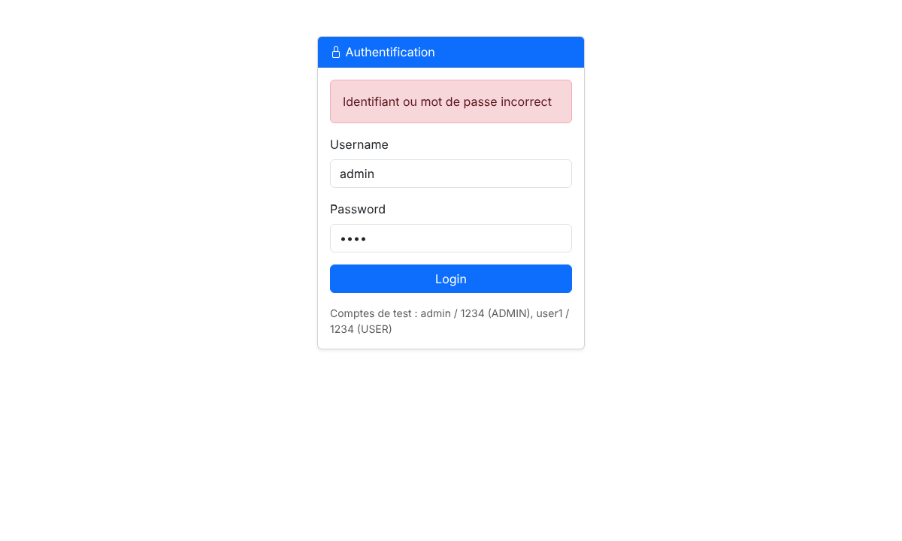
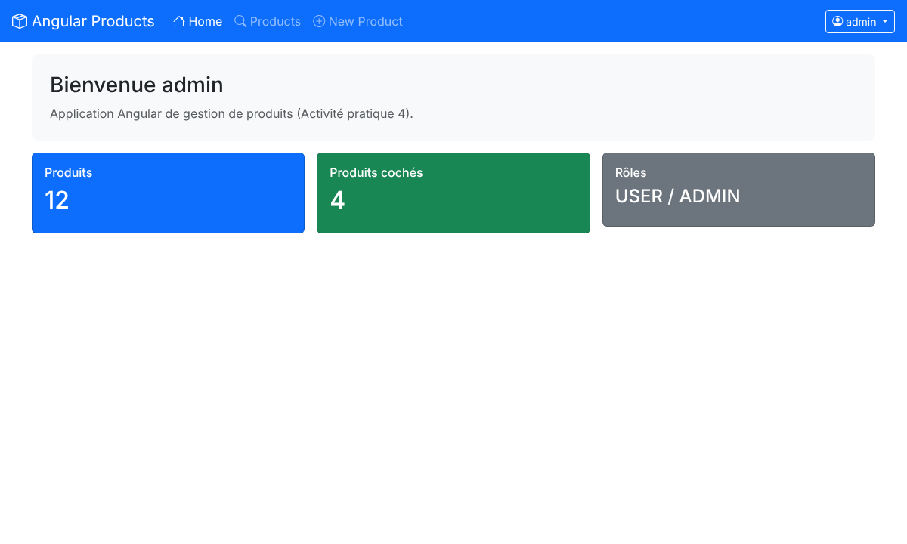
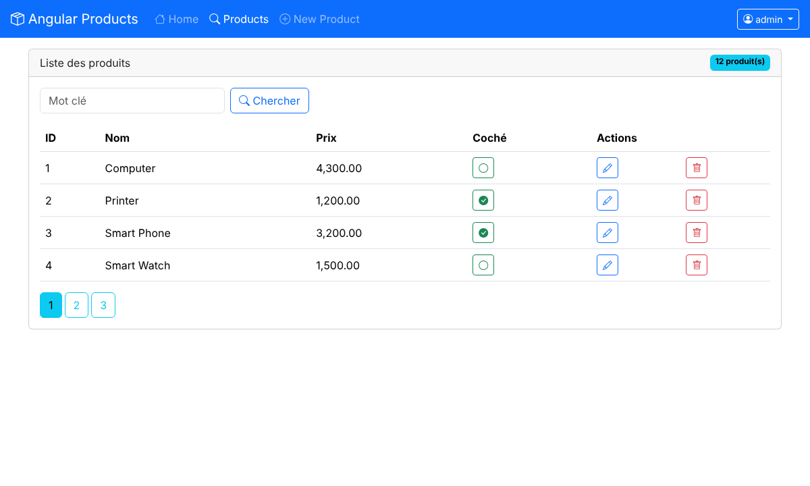
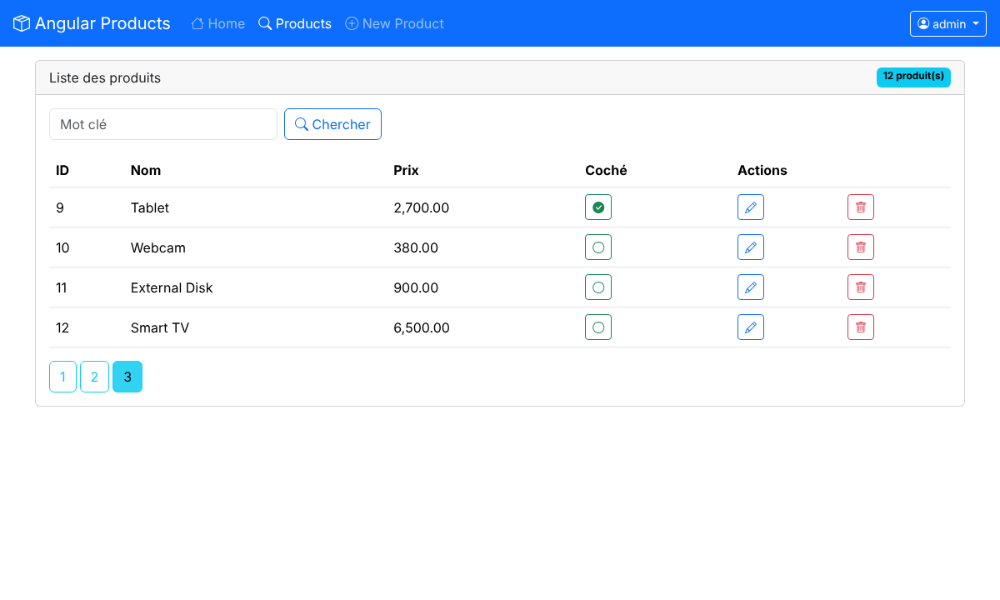
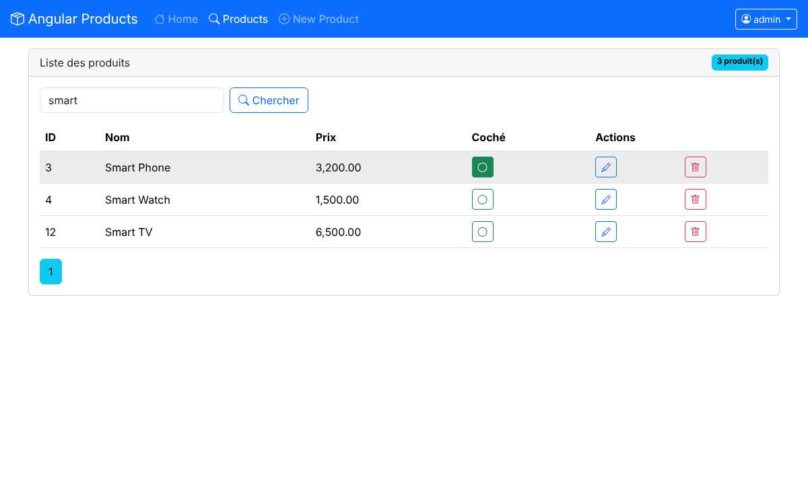
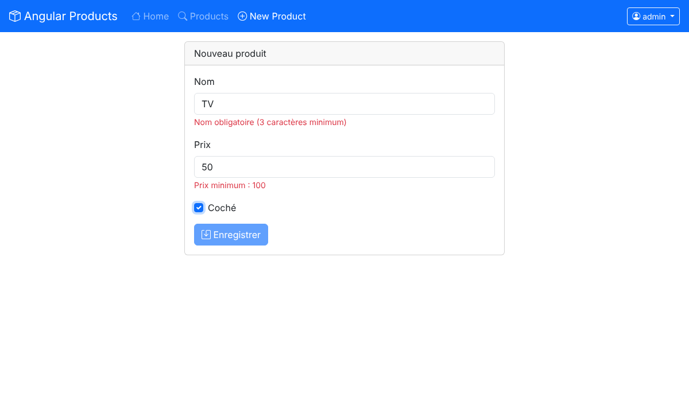
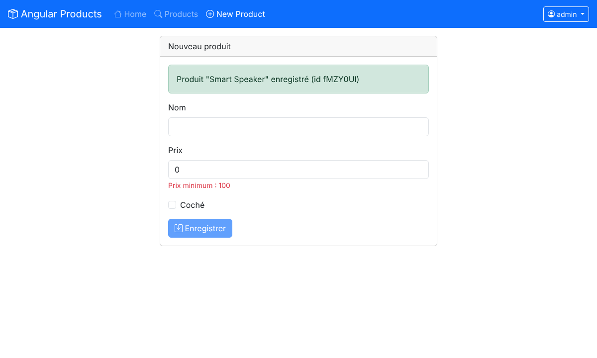
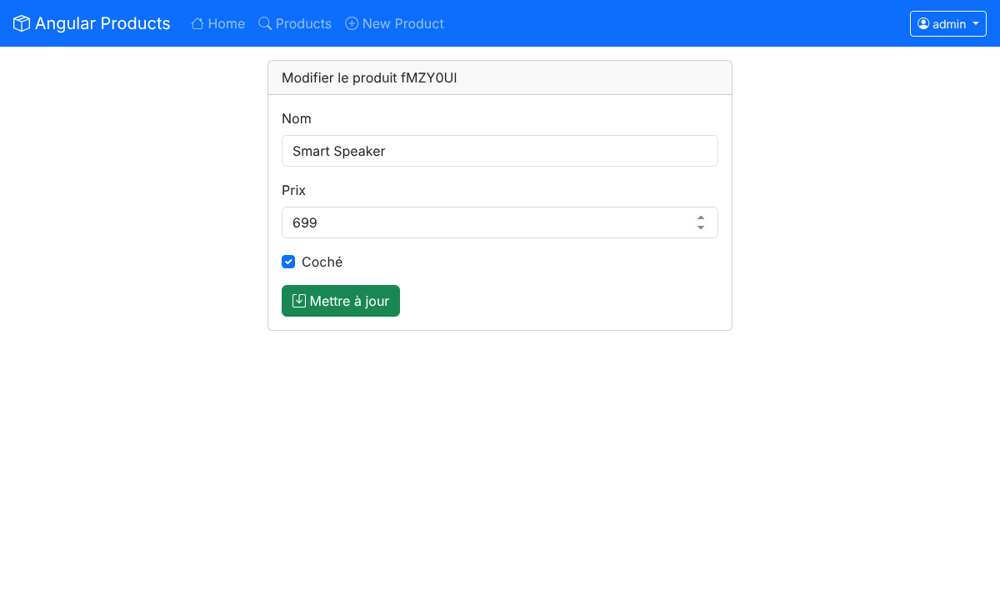
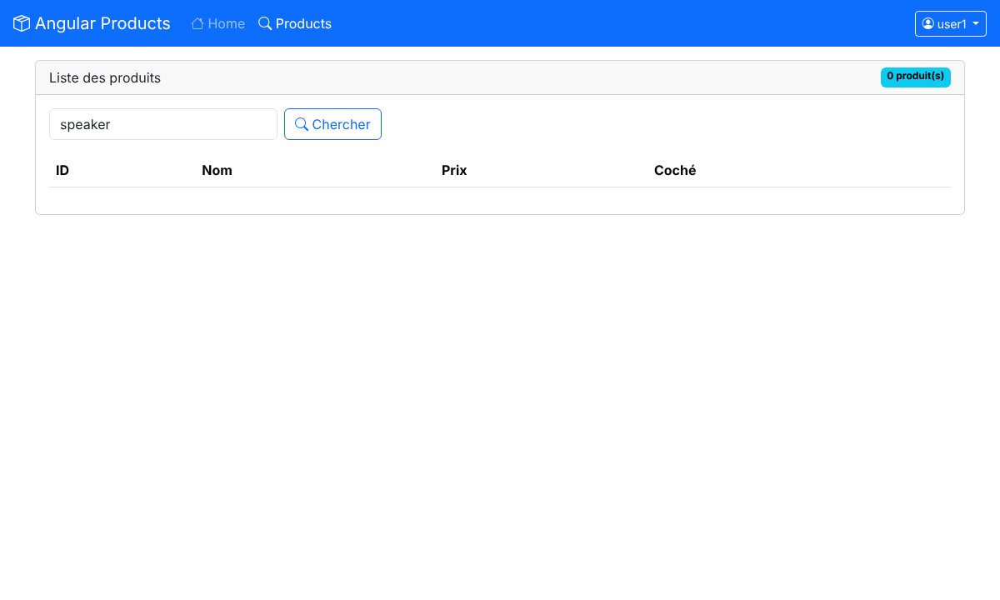
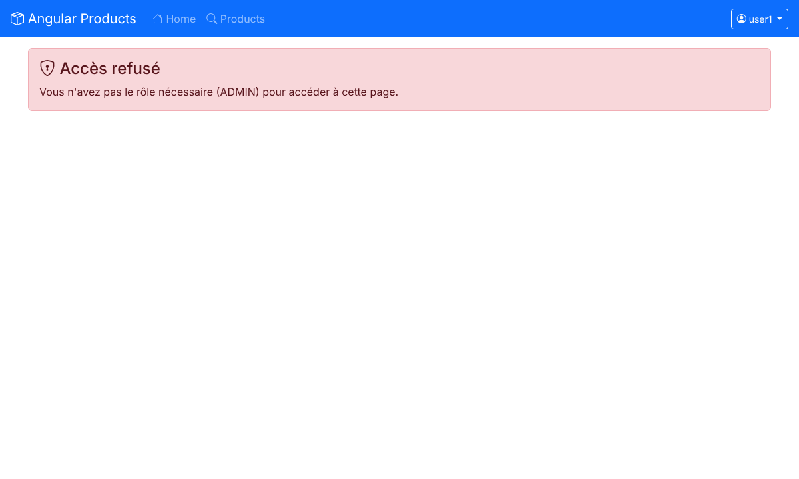

# Activité Pratique N°4 : Angular Framework

**Mohammed ELJIHAD**, Master II-BDCC, ENSET Mohammedia. Module : Architecture JEE et Systèmes Distribués (Pr. Mohamed YOUSSFI).

## Objectif
Comprendre et pratiquer les concepts de base d'Angular à travers une application de gestion de produits :
- composants standalone, data binding et nouveau control flow (`@if`, `@for`) ;
- services et injection de dépendances, `HttpClient` et RxJS ;
- routage, routes enfants et guards ;
- formulaires template-driven et réactifs avec validation ;
- intercepteur HTTP et gestion d'un état global ;
- authentification et autorisation par rôles.

## Technologies
Angular 18 (standalone components), TypeScript, RxJS, Bootstrap 5 et Bootstrap Icons. Le backend REST est simulé avec **json-server** (`db.json`).

## Lancement
```bash
npm install
npm run backend        # json-server sur http://localhost:8089 (products, users)
npm start              # ng serve sur http://localhost:4200
```
Comptes de test : `admin` / `1234` (rôles USER et ADMIN) et `user1` / `1234` (rôle USER).

## Architecture
```
src/app
├── model/product.model.ts             interface Product
├── services/
│   ├── product.service.ts             appels REST (search paginé, check, delete, save, getById, update)
│   ├── app-state.service.ts           état global (produits, pagination, statut LOADING, authentification)
│   └── auth.service.ts                login / logout
├── interceptors/app-http.interceptor  ajoute "Authorization: Bearer …" et gère le statut LOADING (spinner)
├── guards/
│   ├── authentication.guard.ts        /admin/** réservé aux utilisateurs connectés
│   └── authorization.guard.ts         routes réservées au rôle déclaré dans data.requiredRole (ADMIN)
├── login/                             formulaire réactif de connexion
├── admin/                             layout de l'espace connecté (navbar + router-outlet)
├── navbar/                            menu dynamique selon les rôles, spinner, utilisateur, logout
├── home/                              tableau de bord (nombre de produits, produits cochés, rôles)
├── products/                          recherche, pagination, check, édition, suppression
├── new-product/ / edit-product/       formulaires réactifs avec validateurs
└── not-authorized/                    page affichée si le rôle est insuffisant
```

### Routage
```ts
{ path: 'login', component: LoginComponent },
{ path: 'admin', component: AdminComponent, canActivate: [authenticationGuard], children: [
    { path: 'home', component: HomeComponent },
    { path: 'products', component: ProductsComponent },
    { path: 'newProduct', component: NewProductComponent, canActivate: [authorizationGuard], data: { requiredRole: 'ADMIN' } },
    { path: 'editProduct/:id', component: EditProductComponent, canActivate: [authorizationGuard], data: { requiredRole: 'ADMIN' } },
    { path: 'notAuthorized', component: NotAuthorizedComponent } ] }
```

### Concepts mis en œuvre
- **Service et HttpClient** : la recherche paginée utilise `GET /products?name_like=…&_page=…&_limit=…` avec `observe: 'response'`, ce qui permet de lire le nombre total de produits dans l'en-tête `X-Total-Count` et d'en déduire le nombre de pages.
- **État partagé (`AppStateService`)** : le mot-clé et la page courante sont conservés quand on change de vue. L'intercepteur et la navbar lisent le même état, ce qui affiche le spinner pendant les requêtes.
- **Formulaires** :
  - template-driven (`ngModel`) pour la recherche ;
  - réactifs (`FormBuilder`, `Validators.required/minLength/min`) pour le login, l'ajout et l'édition, avec messages d'erreur et bouton désactivé tant que le formulaire est invalide.
- **Interactions** : la case « coché » appelle un `PATCH` et met à jour l'affichage. La suppression demande une confirmation et revient à la page précédente si la page courante devient vide.
- **Sécurité côté client** :
  - les guards fonctionnels (`CanActivateFn`) protègent les routes ;
  - les boutons et menus réservés à l'ADMIN sont masqués avec `@if (appState.hasRole('ADMIN'))` ;
  - l'intercepteur injecte le jeton dans chaque requête.

## Tests réalisés (scénario automatisé, captures dans `captures/`)
Sortie du scénario (`captures/scenario_test.txt`) :
```
Accès direct à /admin/products sans login -> http://localhost:4200/login
Mauvais mot de passe -> Identifiant ou mot de passe incorrect
Login admin -> http://localhost:4200/admin/home
Page 1 : Computer, Printer, Smart Phone, Smart Watch
Page 3 : Tablet, Webcam, External Disk, Smart TV
Recherche "smart" : Smart Phone, Smart Watch, Smart TV
Nouveau produit -> Produit "Smart Speaker" enregistré (id fMZY0Ul)
Après mise à jour : fMZY0Ul | Smart Speaker | 699.00 |
Après suppression, résultats "speaker" : 0
user1 : colonnes = ID, Nom, Prix, Coché ; lien New Product visible = 0
user1 -> /admin/newProduct en rechargeant la page : retour à /login (l'état d'authentification est en mémoire)
user1 -> navigation interne vers /admin/newProduct : http://localhost:4200/admin/notAuthorized
```

| | |
|---|---|
| Login (erreur)  | Accueil admin  |
| Liste paginée  | Page 3  |
| Recherche et check  | Validation du formulaire  |
| Produit enregistré  | Édition  |
| Vue user1 (sans actions ADMIN)  | Accès refusé  |

## Conclusion
- Angular structure une application front-end en composants réutilisables.
- Les services et l'injection de dépendances séparent la logique d'accès aux données de l'affichage.
- Le routeur, les guards et l'intercepteur sécurisent la navigation et centralisent le traitement des requêtes.
- Cette base sera reliée au backend Spring Boot sécurisé par JWT dans le projet *Spring Angular JWT* (e-banking).
